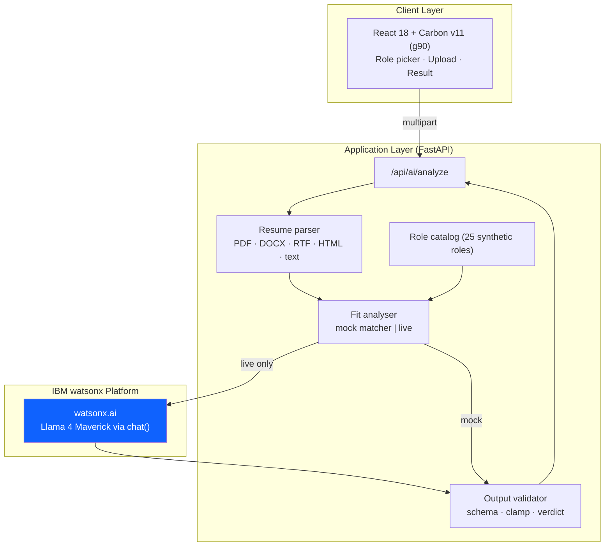

# Architecture - IBM Role-Fit Resume Analyser

## Solution summary

A Carbon React UI and a FastAPI backend. The backend parses an uploaded resume (any format), compares it with a synthetic role profile, and returns an advisory fit score. Mock mode uses a deterministic matcher. Live mode calls watsonx.ai.

## Component inventory

| Component | Technology | Notes |
|---|---|---|
| Frontend | React 18, Vite, @carbon/react 1.120 | 3 routes: analyser, role catalog, architecture |
| Backend | FastAPI, Python 3.11 | in-memory only |
| Parser | pypdf + zipfile/regex | size-capped; no XML parser (XML-bomb safe) |
| Analyser | `services/analyzer.py` | dual-mode, auto-fallback to mock |
| Data | `backend/data/*.json` | synthetic roles and resumes |
| AI | watsonx.ai, `ibm-watsonx-ai` 1.5+ | `project_id` xor `space_id` |

## Data flow

1. UI posts `role_id` and either a file or a `sample_id`.
2. The parser extracts text (image files are rejected), capped at 10 MB and 60k characters.
3. Mock: alias-aware skill matching, weighted 70% required / 30% preferred. Live: `chat()` with a JSON response format.
4. The validator keeps only real role skills, clamps the score, and sets the verdict server-side (75+ Suitable, 50-74 Partially suitable, below 50 Not yet).
5. The response includes an advisory note. Nothing is persisted.

## Security and AI-safety architecture

- Resume content is untrusted and isolated in the user message inside `<resume>` tags.
- The model cannot change the verdict. Hallucinated skills are dropped.
- Credentials come from environment variables only. CORS is limited to local origins.
- Advisory only, with no automated decision. A human reads the result.

## Deployment (planned)

Local first (uvicorn and Vite). Containers target OpenShift (UBI 9, runtime pinned `linux/amd64`). The backend is stateless, so it scales horizontally.

## Non-functional notes

Mock latency is about 600 ms. The live call is bounded by the model, with `max_tokens=900`. WCAG 2.1 AA is addressed through Carbon components, ARIA live regions, a skip link and keyboard-accessible controls.

## IBM product versions

| Product | Version |
|---|---|
| watsonx.ai | Runtime, `ibm-watsonx-ai` 1.5.x or later (1.9.1 import-checked) |
| Carbon | `@carbon/react` 1.120 (v11) |
